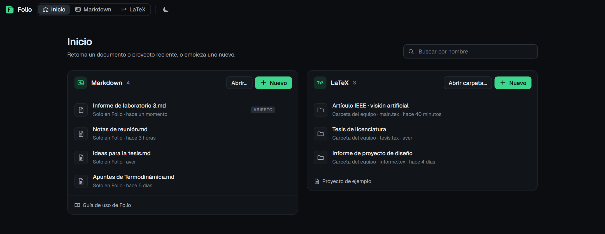
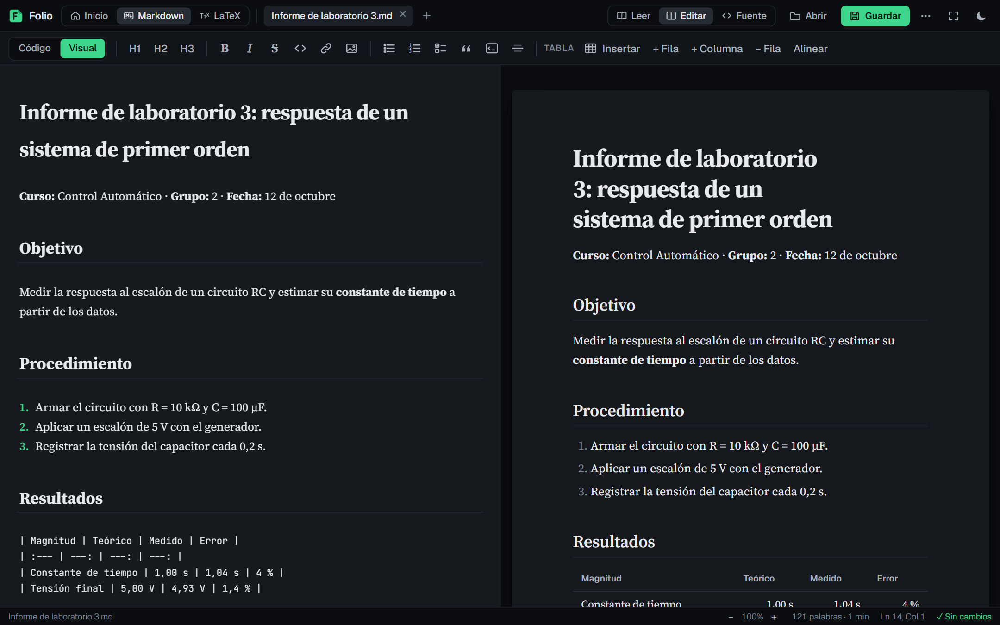
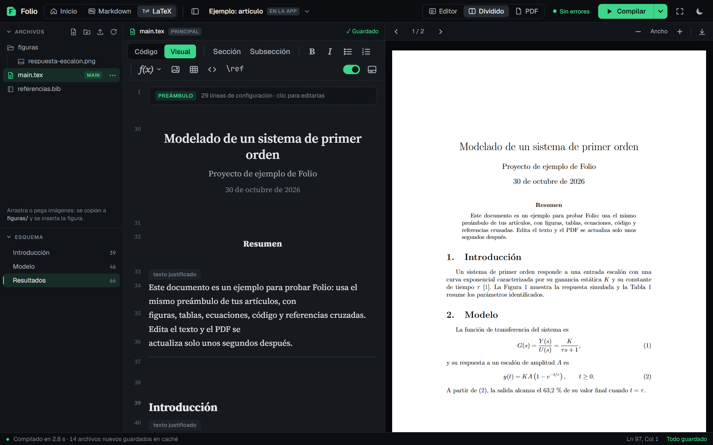

# Folio

**Editor de Markdown y LaTeX que se instala en tu computadora y funciona sin internet.**
Escribe apuntes, informes y artículos con vista previa al lado, compila tus `.tex` a PDF
como en Overleaf y abre tus archivos con doble clic desde el Explorador.

**[Abrir Folio](https://joseh1105.github.io/Folio/)** · gratis, sin cuenta, tus archivos se
quedan en tu equipo.

## Para qué sirve

- **Documentos Markdown (`.md`):** apuntes, informes, guías o notas de reunión. Escribes a
  la izquierda y ves la hoja formateada a la derecha, con tablas, listas de tareas, código y
  citas. Se guarda directamente sobre tu archivo.
- **Proyectos LaTeX (`.tex`):** artículos, tesis e informes técnicos. Compila un PDF real
  (pdfLaTeX de TeX Live) dentro de la app, con errores explicados en español, bibliografía,
  figuras y ecuaciones.
- **Todo en un solo lugar:** la pantalla de **Inicio** reúne tus documentos y proyectos
  recientes para retomarlos con un clic.

No necesitas instalar TeX Live, ni tener cuenta en ningún servicio, ni conexión una vez
configurado: el motor se descarga la primera vez y queda guardado en la app.

## Cómo se ve

### Inicio

Al abrir Folio ves tus documentos Markdown y tus proyectos LaTeX recientes en dos columnas
(la primera imagen de esta página).
Desde aquí creas uno nuevo, abres uno de tu equipo, buscas por nombre o quitas los que ya
no usas (los archivos de tu equipo nunca se borran).

### Markdown

A la izquierda está el texto en modo **Visual**: los títulos, negritas y listas se ven con
formato y la sintaxis se oculta. La línea donde está el cursor muestra el código, así que
editar sigue siendo exacto. A la derecha está la hoja tal como quedará. Con **Código**
vuelves a ver el Markdown completo.

### LaTeX

Como en Overleaf: a la izquierda los archivos del proyecto y el **esquema** de secciones, en
el centro el editor y a la derecha el PDF. En modo **Visual** el preámbulo se pliega,
`\maketitle` muestra el título y el autor, las secciones se ven como títulos y las
ecuaciones se dibujan. El PDF se vuelve a compilar solo unos segundos después de que dejas
de escribir.

## Instalarlo en tu computadora

Folio es una aplicación web instalable: el navegador la instala como un programa normal,
con su ícono, su ventana propia y acceso sin conexión. No hay instalador que descargar.

### Windows (Microsoft Edge o Google Chrome)

1. Abre **<https://joseh1105.github.io/Folio/>** en Edge o Chrome.
2. En la barra de direcciones aparece el botón **Instalar** (un monitor con una flecha o un
   cuadrado con un +). También está en el menú **⋯ › Aplicaciones › Instalar Folio** (Edge)
   o **⋮ › Transmitir, guardar y compartir › Instalar página como aplicación** (Chrome).
3. Pulsa **Instalar**. Si te lo ofrece, marca **Crear acceso directo en el escritorio** y
   **Anclar a la barra de tareas**.

Folio queda en el menú Inicio de Windows como cualquier otro programa.

### Abrir tus archivos con doble clic

1. En el Explorador, clic derecho en un archivo `.md` o `.tex` › **Abrir con** ›
   **Elegir otra aplicación**.
2. Elige **Folio** y marca **Usar siempre esta aplicación**.
3. La primera vez el navegador pregunta si Folio puede abrir ese tipo de archivo: acepta.

Desde entonces, el doble clic abre el archivo directamente en Folio, en su modo.

### macOS y Linux

Funciona igual con Chrome o Edge: abre la dirección y usa **Instalar**. En Safari usa
**Archivo › Añadir al Dock**. Para abrir archivos con doble clic, elige Folio en
**Abrir con** del Finder o del gestor de archivos.

### Actualizar y desinstalar

- **Actualizar:** es automático. Cuando hay una versión nueva, Folio la usa la próxima vez
  que la abres.
- **Desinstalar:** dentro de Folio, menú del navegador (**⋯** arriba a la derecha) ›
  **Desinstalar Folio**, o desde **Configuración › Aplicaciones** de Windows.

## Primeros pasos

- **Markdown:** en Inicio pulsa **Nuevo** (columna Markdown) o **Abrir…** para elegir un
  `.md`. También puedes soltar el archivo sobre la ventana. Arriba eliges **Leer**,
  **Editar** (texto y hoja lado a lado) o **Fuente** (solo texto). `Ctrl+S` guarda.
- **LaTeX:** en Inicio pulsa **Nuevo** (columna LaTeX) y elige una carpeta: Folio crea
  `main.tex` con un preámbulo listo y la carpeta `figuras/`. Para un proyecto que ya tienes,
  usa **Abrir carpeta…** o suelta la carpeta en la ventana. El **Proyecto de ejemplo**
  enseña todas las funciones.

## Funciones

### Markdown

- Vista de hoja para leer, con índice de secciones a la izquierda.
- Barra de formato: títulos, negrita, cursiva, enlaces, imágenes, listas, tareas, citas,
  bloques de código y tablas (insertar, añadir filas y columnas, alinear).
- **Ecuaciones:** escribe `$…$` para una fórmula en el texto y `$$…$$` para una en su
  propia línea (también en varias líneas), con la sintaxis de LaTeX: fracciones, matrices
  (`bmatrix`), integrales, letras griegas… Se dibujan en la hoja, en el modo Visual y en el
  HTML exportado. Un precio como `$5` no se confunde con una fórmula, y `\$` escribe un
  dólar literal.
- Modo **Visual** o **Código** en el editor.
- **Columna de texto ajustable:** pasa el ratón por el editor y arrastra cualquiera de los
  dos tiradores laterales; la columna se mantiene centrada.
- La línea entre el texto y la hoja reparte el espacio (también con las flechas del teclado).
- **Doble clic en la hoja** abre el texto en esa misma palabra.
- Exportar como HTML, imprimir o guardar en PDF.

### LaTeX

- **Compilación real a PDF** (pdfLaTeX + BibTeX) dentro de la app, automática al escribir o
  con **Compilar** (`Ctrl+Enter`).
- **Errores en español** en el panel de problemas; clic en uno y saltas a la línea.
- **Doble clic en el PDF** salta a la línea del código donde está esa palabra (SyncTeX).
- **Esquema** de secciones y de los archivos incluidos con `\input`.
- **Menú de ecuaciones** (*f(x)*): fracciones, potencias, subíndices, raíces, integrales,
  sumatorias, límites, derivadas, matrices y símbolos. Si tienes código seleccionado, el
  formato se aplica sobre él.
- **Imágenes:** arrástralas o pégalas (`Ctrl+V`) en el editor; se copian a `figuras/` y se
  inserta la figura.
- Autocompletado de comandos, `\ref`, `\cite` y archivos.
- Disposición **Editor**, **Dividido** o **PDF**, y **modo enfoque** (`Ctrl+.`).
- Incluye la clase **IEEEtran** con sus estilos de bibliografía.

### General

- Tema oscuro y claro.
- Funciona sin internet una vez instalado.
- Tus archivos se leen y guardan directamente en tu equipo; no se suben a ningún servidor.

## Atajos de teclado

| Acción | Atajo |
| --- | --- |
| Guardar | `Ctrl+S` |
| Guardar como (Markdown) | `Ctrl+Shift+S` |
| Abrir | `Ctrl+O` |
| Alternar leer y editar (Markdown) | `Ctrl+E` |
| Negrita / cursiva | `Ctrl+B` / `Ctrl+I` |
| Enlace (Markdown) | `Ctrl+K` |
| Compilar (LaTeX) | `Ctrl+Enter` |
| Autocompletar comando (LaTeX) | `Ctrl+Espacio` |
| Comentar líneas (LaTeX) | `Ctrl+/` |
| Ir a la línea (LaTeX) | `Ctrl+G` |
| Modo enfoque | `Ctrl+.` (salir con `Esc`) |

## Sin conexión y almacenamiento

- La primera compilación de LaTeX descarga el motor y la base de TeX Live (unos 125 MB).
  Queda guardada en la app y no se vuelve a descargar.
- Los paquetes que no están en la base (por ejemplo `booktabs`, `listings` o `babel` en
  español) se descargan uno a uno la primera vez que un documento los pide y se reutilizan
  en todos tus proyectos. Después de eso, Folio compila sin internet.
- **Motor y paquetes descargados…** (menú junto a Compilar) muestra cuánto ocupa y permite
  borrarlo.
- Folio no trae todas las clases de revistas y congresos que tiene Overleaf. Si una
  plantilla usa otra clase (`elsarticle`, `acmart`, `llncs`…), copia su archivo `.cls` a la
  carpeta del proyecto, junto al archivo principal.

## Para desarrolladores

Folio es HTML, CSS y JavaScript sin framework, con
[CodeMirror 5](https://codemirror.net/5/), [PDF.js](https://mozilla.github.io/pdf.js/),
[KaTeX](https://katex.org/) y el motor [BusyTeX](https://github.com/TeXlyre/texlyre-busytex)
(TeX Live en WebAssembly).

- `index.html`: interfaz y estilos. El sistema visual está descrito en [DESIGN.md](DESIGN.md).
- `js/`: `home.js` (Inicio), `markdown.js`, `tex.js` y `tex-engine.js` (LaTeX), `visual.js`
  (modo Visual), `shell.js` (arranque y apertura de archivos), `ui.js` (utilidades).
- `tools/build-site.sh`: construye el sitio completo con el motor y el espejo de paquetes.
  Lo ejecuta la acción de GitHub [`publicar.yml`](.github/workflows/publicar.yml) en cada
  `push` a `main` y lo publica en GitHub Pages.
- `graphify-out/`: mapa del código generado con graphify.

**Publicar tu propia copia:** haz un fork, ve a **Settings › Pages › Source** y elige
**GitHub Actions**. La acción construye y publica el sitio en
`https://TU-USUARIO.github.io/Folio/`.

## Licencia

AGPL-3.0-or-later, por el motor BusyTeX. Ver [LICENSE](LICENSE) y los avisos de terceros en
[NOTICE.md](NOTICE.md).
